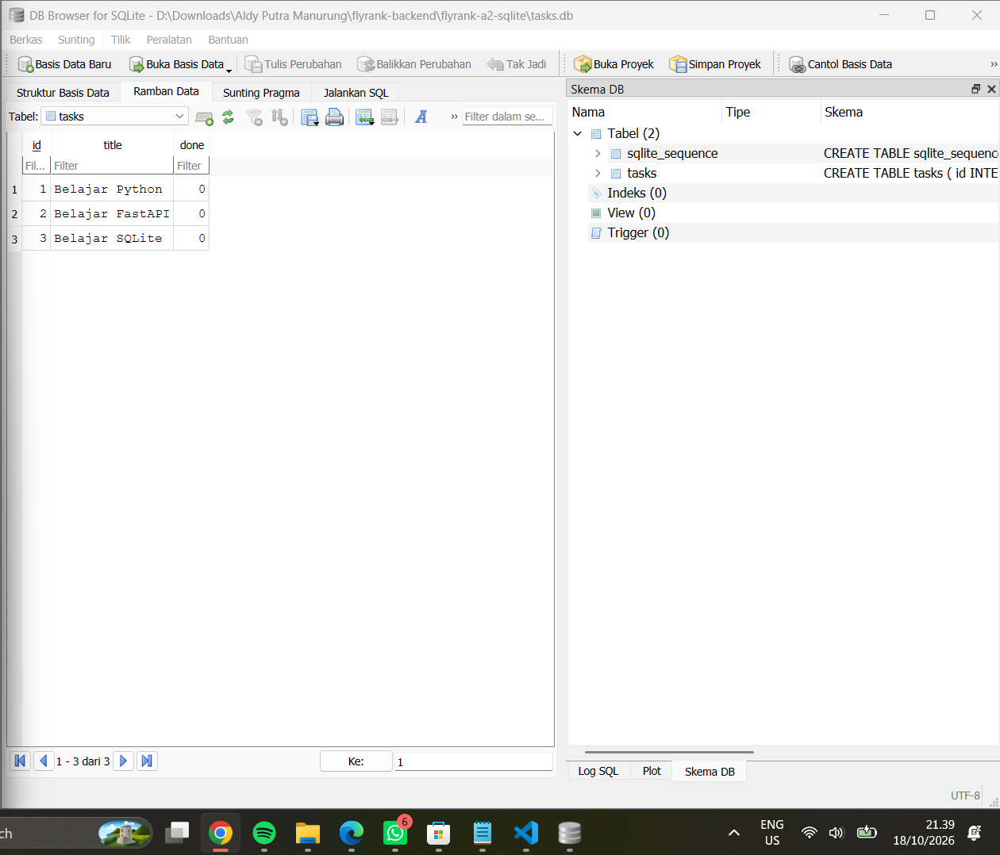

# FlyRank Task API and AI Classification

A REST API built with Python, FastAPI, SQLite, Pydantic, and OpenRouter.
This project combines CRUD operations with an AI-powered support-message
classification endpoint.

## Internship Assignment

- Track: Backend AI Engineering
- Assignment: BE-07, Connect to an AI API
- AI provider: OpenRouter
- Language: Python
- Framework: FastAPI

## Features

### Task API

- Create, retrieve, update, and delete tasks.
- Validate task input using Pydantic.
- Return an error when a task does not exist.
- Persist task data using SQLite.

### AI Classification API

- Classify support messages into billing, bug, feature, or other.
- Assign urgency as low, normal, or high.
- Return a confidence score and a short reason.
- Validate model output against a strict Pydantic schema.
- Reject unexpected input fields and invalid message lengths.
- Use bounded network retries and one output-repair attempt.
- Apply a request timeout.
- Support a local stub mode and an AI kill switch.
- Evaluate predictions using a JSON evaluation dataset.

## AI Endpoint

### POST /ai/classify

Request:

```json
{
  "text": "I was charged twice for my subscription."
}
```

Example response:

```json
{
  "category": "billing",
  "urgency": "high",
  "confidence": 0.95,
  "reason": "Customer reports being charged twice for their subscription."
}
```

The response above is an example. Actual predictions depend on the model output.

### Allowed values

- `category`: `billing`, `bug`, `feature`, `other`
- `urgency`: `low`, `normal`, `high`
- `confidence`: number from 0.0 to 1.0
- `reason`: short explanation

The endpoint accepts a `text` field containing 1 to 2000 characters.
Unexpected request fields are rejected.

## Requirements

- Python 3.10 or later
- FastAPI
- Uvicorn
- SQLite
- Pydantic
- OpenAI-compatible Python SDK
- python-dotenv
- An OpenRouter API key for live AI requests

## Installation

Install dependencies:

```powershell
python -m pip install -r requirements.txt
```

Create a local environment file from the example:

```powershell
Copy-Item .env.example .env
```

Edit `.env` locally and configure:

```text
LLM_BASE_URL=https://openrouter.ai/api/v1
LLM_API_KEY=your_actual_key
LLM_MODEL=openrouter/free
LLM_STUB=1
AI_ENABLED=false
```

Replace `your_actual_key` with your own API key.
Never commit `.env` or share the API key publicly.

The values above keep the application in stub mode.
To make live AI requests, set:

```text
LLM_STUB=0
AI_ENABLED=true
```

Use a model identifier supported by OpenRouter if the configured model
identifier is unavailable.

## Run the API

Start the development server:

```powershell
python -m uvicorn main:app --reload
```

Open the interactive API documentation:

http://127.0.0.1:8000/docs

Find `POST /ai/classify` and use **Try it out** to test a classification.

## Testing

Run the unit tests:

```powershell
python -m unittest discover -s tests -v
```

Run the local evaluation:

```powershell
python tests/evaluate_ai.py
```

Run the evaluation against the configured AI provider:

```powershell
python tests/evaluate_ai.py --live
```

The live evaluation makes real provider requests and may consume API credits
if the selected model or provider configuration is not free.

The evaluation report is written to:

`tests/eval-results.json`

The report records the evaluation mode, number of cases, correct predictions,
accuracy, and individual case results.

## Job Card

The classification task and its input/output contract are documented in
`JOB-CARD.md`.

The system prompt is stored in:

`prompts/classify_v1.txt`

## Project Structure

```text
flyrank-a2-sqlite/
├── main.py
├── ai_routes.py
├── ai_service.py
├── prompts/
│   └── classify_v1.txt
├── tests/
│   ├── eval_cases.json
│   ├── eval-results.json
│   ├── evaluate_ai.py
│   └── test_ai_endpoint.py
├── .env.example
├── .gitignore
├── JOB-CARD.md
├── requirements.txt
├── README.md
├── database-tasks.png
└── sql-query-result.png
```

The SQLite database is created locally by the application.
The database file and environment secrets should not be committed.

## Existing SQLite Evidence

The original CRUD assignment includes screenshots of the SQLite task table
and a SQL query result.

### Database table



### SQL query result

```sql
SELECT id, title, done
FROM tasks
ORDER BY id;
```

See `database-tasks.png` and `sql-query-result.png` for the original evidence.

## Author

Aldy Putra Manurung

## Internship Track

FlyRank AI Internship: Backend AI Engineering
