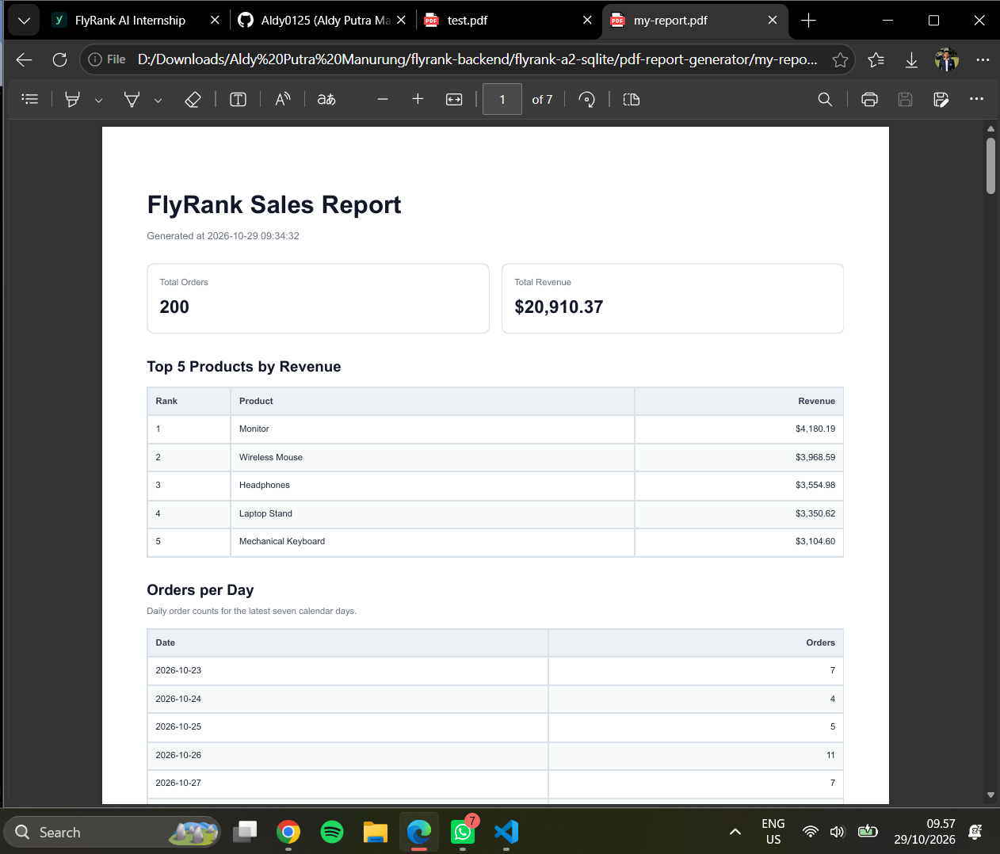

@'
# BE-08: PDF Report Generator

A Python backend application that queries sales data from SQLite, aggregates the results, generates PDF reports from HTML using Playwright and Chromium, and serves reports through a FastAPI API.

## Features

- SQLite database containing 200 synthetic sales orders.
- SQL aggregation for total orders and total revenue.
- Top five products ranked by revenue.
- Daily order counts over the latest seven-day reporting window.
- HTML-to-PDF rendering with Playwright and Chromium.
- PDF storage on disk with download endpoints.
- FastAPI background tasks for report generation.
- Report status tracking through a metadata endpoint.
- Daily report reuse to avoid unnecessary duplicate generation.
- Optional forced report generation using `{"force": true}`.
- PDF preview screenshot included in the repository.

## Tech Stack

- Python
- FastAPI
- SQLite
- Playwright
- Chromium
- Uvicorn

## Dataset

The application uses a synthetic shop dataset with 200 orders across six products.

Each order contains an ID, customer, product, amount, and creation date.

The database and generated PDF files are local runtime artifacts. They should not be committed to Git.

## Setup and Run

Open PowerShell in the `pdf-report-generator` directory.

Create and activate a virtual environment:

```powershell
python -m venv .venv
.\.venv\Scripts\Activate.ps1
```

Install dependencies and Chromium:

```powershell
python -m pip install -r requirements.txt
playwright install chromium
```

Initialize the sample dataset:

```powershell
python seed.py
```

Start the API:

```powershell
uvicorn main:app --reload --port 8000
```

### Health Check

```powershell
curl.exe -i http://127.0.0.1:8000/health
```

Expected response:

```json
{"status":"ok"}
```

## SQL Aggregation

### 1. Total Orders

```sql
SELECT COUNT(*) AS total_orders
FROM orders;
```

### 2. Total Revenue

```sql
SELECT ROUND(
    COALESCE(SUM(amount), 0),
    2
) AS total_revenue
FROM orders;
```

### 3. Top Five Products by Revenue

```sql
SELECT
    product,
    ROUND(SUM(amount), 2) AS revenue
FROM orders
GROUP BY product
ORDER BY revenue DESC, product ASC
LIMIT 5;
```

### 4. Orders per Day

The application calculates the seven-day reporting window in Python and passes the date boundaries as SQL parameters.

```sql
SELECT
    date(created_at) AS day,
    COUNT(*) AS total_orders
FROM orders
WHERE date(created_at) BETWEEN ? AND ?
GROUP BY date(created_at)
ORDER BY day ASC;
```

Dates without orders are included with a count of zero.

## API Endpoints

| Method | Endpoint | Purpose |
|---|---|---|
| GET | `/health` | Check API health |
| POST | `/reports` | Create or reuse a report |
| GET | `/reports/{id}` | Retrieve report metadata and status |
| GET | `/reports/{id}/file` | Download the generated PDF |

## Generate a Report

```powershell
curl.exe -i -X POST http://127.0.0.1:8000/reports
```

When a new report is scheduled for generation, the API returns HTTP `202 Accepted` with a response similar to:

```json
{
  "id": 3,
  "status": "queued",
  "status_url": "/reports/3",
  "file": "/reports/3/file"
}
```

The ID depends on the current database state.

The API schedules report generation through FastAPI background tasks. The client receives a report ID without waiting for the PDF rendering operation to finish.

## Check Report Status

Use the ID returned by the creation endpoint:

```powershell
curl.exe -i http://127.0.0.1:8000/reports/3
```

A newly scheduled report can initially have status `queued`. Poll the status endpoint until the report reaches `completed` before downloading the file.

The completed response includes the report ID, creation timestamp, completion timestamp, status, and download link, as implemented by the API.

## Download a Report

Replace `3` with the report ID returned by the API:

```powershell
curl.exe -f -o verify-report.pdf http://127.0.0.1:8000/reports/3/file
```

Open the downloaded file:

```powershell
Start-Process .\verify-report.pdf
```

Download the report only after its status is `completed`.

## Force a New Report

By default, the API reuses an existing valid report for the current day.

To request a new report regardless of the daily reuse check:

```powershell
curl.exe -i -X POST `
  -H "Content-Type: application/json" `
  -d '{"force":true}' `
  http://127.0.0.1:8000/reports
```

A new generation request returns HTTP `202 Accepted`.

## Error Handling

Requesting an unknown report ID returns HTTP `404 Not Found`.

The download endpoint also returns an error when the report record or its PDF file does not exist.

## Background Job Design

Report generation runs through FastAPI background tasks. This allows the API to return a report ID and status endpoint before PDF rendering finishes.

The client can check progress through `GET /reports/{id}` and download the PDF when the report reaches `completed`.

FastAPI background tasks run within the application process. They do not provide a durable job queue, and pending work is not guaranteed to survive a process crash or restart.

A persistent job queue and recovery mechanism would be appropriate future improvements if the assignment requires stronger job durability.

## Verification Results

The following behaviors were verified locally during development:

- `GET /health` returned HTTP `200 OK`.
- `POST /reports` returned HTTP `202 Accepted` for a new report.
- A new report initially returned status `queued`.
- `GET /reports/3` subsequently returned status `completed`.
- The completed report was downloaded successfully.
- The PDF download endpoint returned `application/pdf`.
- Repeated report requests reused an existing valid daily report.
- Using `{"force": true}` created a new report.
- An unknown report ID returned HTTP `404 Not Found`.
- Four report aggregation unit tests passed.

These results describe the local tests performed during development. They do not establish persistence across application restarts or scheduled report generation.

## PDF Report Preview

The following image shows the first page of the generated PDF report.



## Testing

Run the aggregation unit tests from the `pdf-report-generator` directory:

```powershell
python -m unittest -v test_report_data.py
```

Run a Python syntax check:

```powershell
python -m compileall main.py report_data.py report_renderer.py
```

The unit tests cover:

- Total order calculation.
- Total revenue calculation.
- Top five products by revenue.
- Daily order counts across the seven-day reporting window.

All tests should pass before submitting the assignment.

## Project Structure

```text
pdf-report-generator/
├── docs/
│   └── pdf-report-page1.png
├── reports/
├── main.py
├── report_data.py
├── report_renderer.py
├── seed.py
├── check_db.py
├── test_report_data.py
├── requirements.txt
└── README.md
```

The `report.db` database and generated PDF files are local artifacts and should not be committed to Git. The screenshot under `docs/` is documentation and should be committed.

## Future Improvements

Potential extensions include:

- Persistent background job processing.
- Job recovery after application restarts.
- Scheduled report generation.
- Email delivery of report links.
- Improved report monitoring and failure recovery.

Scheduled generation and durable job processing are separate capabilities from the background tasks implemented in this version.
'@ | Set-Content -Path .\pdf-report-generator\README.md -Encoding utf8
